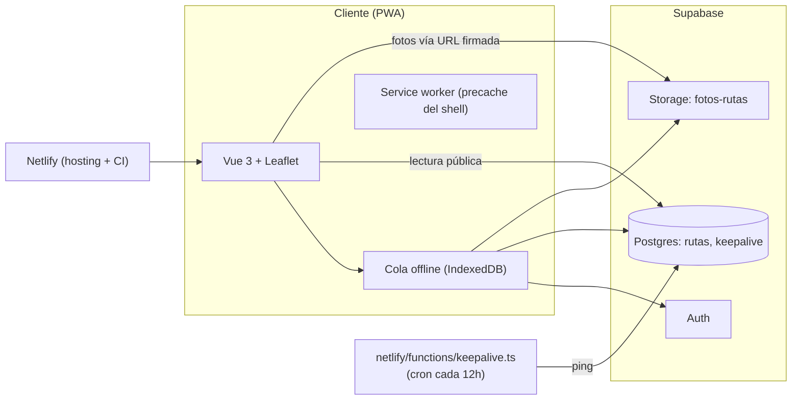

# Rutácora

Rutas de senderismo en un mapa interactivo de España: un único editor con sesión, y mapa de solo lectura abierto a cualquier visitante.

[](https://github.com/Rubenesky/Rutacora/actions/workflows/ci.yml)

**Demo:** <!-- TODO: URL de Netlify tras el despliegue -->

## Qué es y por qué

Después de una ruta de senderismo, lo normal es querer apuntar dónde ha sido, cuánto ha durado y cómo de dura era, muchas veces con el móvil sin cobertura y la batería baja. Rutácora es ese cuaderno: un mapa donde cada ruta queda marcada con sus datos y una foto, pensado para usarse en el momento, en el campo, con o sin conexión. El mapa en sí es público (cualquiera puede verlo y consultar las rutas), pero solo quien tiene sesión puede añadir, editar o borrar — sus propias rutas, nunca las de otra persona.

## Funcionalidades

- Mapa interactivo (Leaflet) con capas OpenStreetMap, OpenTopoMap, IGN (Mapa Topográfico Nacional) y PNOA (ortofoto satélite), con agrupación de marcadores (clustering). Marcadores propios (SVG en línea, sin imágenes de archivo): pin rojo para rutas sincronizadas, naranja con un reloj para las pendientes de sincronizar, azul con una retícula para el punto de ubicación del formulario.
- El nombre "Rutácora" de la barra actúa como botón de inicio: vuelve a la vista inicial del mapa.
- Lectura pública sin necesidad de cuenta: nombre, ubicación, distancia, desnivel, duración, tipo, fecha, dificultad, notas y foto de cada ruta.
- Sesión (un único editor) para añadir, editar y borrar rutas: formulario con ubicación por mapa, arrastre del marcador o geolocalización del dispositivo.
- Foto de portada por ruta: EXIF leído solo para auto-rellenar la ubicación (nunca se sube), orientación corregida, redimensionada y recomprimida en el propio navegador antes de subirla.
- Lista de rutas ordenable (nombre, fecha, distancia), con panel lateral en escritorio y hoja inferior en móvil.
- Cola de guardado offline: añadir, editar y borrar funcionan sin conexión y se sincronizan solos al recuperarla.
- PWA instalable, con el shell disponible sin conexión y aviso de actualización que nunca recarga la página sin permiso.
- Exportar datos: con sesión, descarga un JSON con todas las rutas propias (sin fotos, sin URLs firmadas, sin pendientes de la cola).
- Keep-alive programado (Netlify Scheduled Function) contra `public.keepalive`, para que el plan gratuito de Supabase no pause el proyecto por inactividad.

## Capturas

_(Carpeta `docs/img/`, con datos de ejemplo — ver la lista de capturas pendientes en la respuesta donde se entregó este README.)_

| | |
|---|---|
|  Mapa público, sin sesión |  Popup de una ruta propia, con sesión |
|  Formulario "Añadir ruta" |  Panel "Rutas" en móvil |

## Stack y decisiones

| Decisión | Motivo |
|---|---|
| Vue 3 (Composition API, `<script setup>`) + Vite + TypeScript estricto | Stack moderno, tipado de extremo a extremo, arranque de desarrollo rápido. |
| Leaflet + leaflet.markercluster directo, sin wrapper (`vue-leaflet` u otro) | El mapa necesita control fino sobre popups con contenido dinámico (acciones según sesión, foto cargada tarde) y recolocación manual; un wrapper añadía una capa de indirección sin aportar nada aquí. |
| Marcadores con `L.divIcon` y SVG en línea, nunca `L.Icon.Default` | Los PNG por defecto de Leaflet (`marker-icon-2x.png`, `marker-shadow.png`) no sobreviven al build de Vite: Leaflet construye esas URLs concatenando texto en tiempo de ejecución, así que Vite nunca las detecta como asset y no las empaqueta — en producción, esas peticiones las responde el propio `index.html` (fallback de SPA) y el navegador no puede decodificarlo como imagen. Confirmado reproduciendo con `npm run build` + `npm run preview` (ver `src/lib/iconosRuta.ts`). |
| Supabase (Postgres + Auth + Storage) | Backend completo sin mantener servidor propio; RLS a nivel de fila y de columna resuelve el modelo "público de lectura, privado de escritura" sin lógica de autorización en el cliente. |
| Cola offline en IndexedDB (`idb`), no una librería de sincronización genérica | El caso de uso es simple y acotado (guardar/editar/borrar una ruta) y necesita reglas propias (qué pasa si caduca la sesión, qué pasa si la foto falla a mitad); una librería genérica no encajaba mejor que escribirlo directamente. |
| Compresión de foto propia sobre `canvas`, no `browser-image-compression` | Se necesitaba control exacto sobre la corrección de orientación EXIF y un resultado determinista para poder testearlo; la librería de terceros no ofrecía ese control fino (ver `src/lib/procesarFoto.ts`). |
| PWA con `vite-plugin-pwa` | Integración directa con Vite, service worker generado (Workbox) sin mantenerlo a mano. |
| Netlify | Despliegue estático con funciones programadas incluidas (para el keep-alive, ver "Hoja de ruta": todavía no implementada) y variables de entorno gestionadas. |

## Arquitectura



## Modelo de datos y seguridad

Tabla `public.rutas` (RLS activado): `id` (uuid, lo genera el cliente para que los reintentos de la cola sean idempotentes), `user_id`, `nombre`, `lat`/`lon`, `distancia_km`, `desnivel_m`, `duracion_min`, `tipo`, `fecha`, `dificultad`, `notas`, `foto_path`, `created_at`.

- **anon** (sin sesión): `GRANT SELECT` solo sobre las columnas públicas (sin `user_id` ni `created_at`, mediante "Column Level Privileges" de Postgres/Supabase) y una política RLS de solo lectura. No tiene `INSERT`/`UPDATE`/`DELETE`.
- **authenticated** (con sesión): lee la tabla completa, y cuatro políticas separadas — una por operación — limitan `INSERT`/`UPDATE`/`DELETE` a las filas donde `user_id = auth.uid()`.
- El bucket de Storage `fotos-rutas` es **privado** (`public = false`): nunca listable ni descargable por URL directa. Una política permite a `anon` leer un objeto conocido (vía URL firmada, caducan en 1 hora) sin poder listar el bucket; `authenticated` puede subir/editar/borrar solo dentro de su propia carpeta `{user_id}/`.
- La `anon key` es pública por diseño (viaja en el bundle del cliente): la seguridad real no depende de ocultarla, sino de las políticas RLS y los GRANT de arriba. En el cliente nunca se usa `service_role`.
- Exclusión de buscadores: `index.html` lleva `<meta name="robots" content="noindex, nofollow">` y `netlify.toml` añade la cabecera `X-Robots-Tag: noindex, nofollow` en todas las rutas (doble refuerzo: cualquier buscador que respete una de las dos formas, la respeta). **A propósito no hay `robots.txt` con `Disallow`**: bloquear el rastreo le impediría al buscador llegar a leer esa meta/cabecera, y una URL bloqueada por `robots.txt` puede seguir apareciendo en resultados (sin descripción) si alguien la enlaza desde fuera — lo contrario de lo que se busca. Con el rastreo permitido y `noindex`, el buscador entra, lee la instrucción y no indexa la página. **`noindex` no es control de acceso**: no es un buscador de rutas públicas pensado para indexarse, pero cualquiera con el enlace directo puede abrir la web igualmente; la seguridad real de los datos está en RLS (ver más abajo), no en ocultar la URL.
- Las fotos se recomprimen en el navegador antes de subir (`src/lib/procesarFoto.ts`), lo que también elimina el EXIF/GPS original del archivo final.

### Qué es público

Sin sesión se ve: nombre, coordenadas, distancia, desnivel, duración, tipo, fecha, dificultad, notas y foto de cada ruta. No se ve `user_id` ni `created_at`.

> **Aviso:** no registres rutas que empiecen en un domicilio — las coordenadas del punto de inicio son públicas.

## Offline

`src/composables/useOfflineQueue.ts` es el único punto de entrada para guardar/editar/borrar: todo pasa primero por IndexedDB.

- **Idempotencia:** el `id` de cada ruta lo genera el cliente (`crypto.randomUUID()`), así que un reintento tras un fallo a mitad repite el mismo `upsert`/`delete`, nunca duplica.
- **Estados de cada elemento de la cola:** `pendiente` (esperando sincronizar), `pendiente_login` (sin sesión usable en el momento de sincronizar), `pendiente_login_otra_cuenta` (hay sesión, pero de una cuenta distinta a la que lo encoló), `error` (falló y se reintentará solo, salvo que sea un error de permisos, que requiere reintento manual).
- **Sesión caducada sin red:** `supabase-js` conserva la sesión guardada si falla el refresco del token por un error de red, y solo la invalida ante un rechazo explícito del servidor (ver `src/composables/useAuth.ts`). Si de verdad no hay sesión usable al sincronizar, el elemento queda `pendiente_login` en vez de perderse.
- **Limitaciones:** una sola foto por ruta; sin capa de mapa offline (ver "Limitaciones" más abajo); sin GPX; la exportación de datos (JSON, con sesión) tampoco incluye fotos.

## Puesta en marcha

Requisitos: Node 22, una cuenta de Supabase.

1. Crea un proyecto en [supabase.com](https://supabase.com).
2. En el **SQL Editor**, ejecuta el contenido completo de `supabase/schema.sql`.
3. En **Authentication → Users**, crea el único usuario editor a mano, con **Auto Confirm User** activado (no hay registro público: el formulario de alta está deshabilitado a propósito).
4. Copia `.env.example` a `.env.local` y rellena:

   ```
   VITE_SUPABASE_URL=...
   VITE_SUPABASE_ANON_KEY=...
   ```

   `VITE_SUPABASE_URL` es solo el origen del proyecto (`https://TU-PROYECTO.supabase.co`), **sin** `/rest/v1` ni barra final — `src/lib/supabaseUrl.ts` lo valida al arrancar y avisa si se cuela alguna de esas dos cosas.

5. Instala y arranca:

   ```bash
   npm install
   npm run dev          # servidor de desarrollo
   npm run lint         # ESLint
   npm run typecheck    # vue-tsc
   npm test             # Vitest
   npm run build        # build de producción (vue-tsc -b + vite build)
   npm run generate-pwa-assets  # regenera los iconos de la PWA desde public/favicon.svg
   ```

## Tests y CI

`npm test` (Vitest + jsdom + `@vue/test-utils`) cubre, entre otras cosas: la regla de propiedad de rutas (Editar/Borrar solo del dueño, incluida la regresión de la carrera de sesión al arrancar), el interruptor y la mutua exclusión de los paneles superpuestos (Rutas/login/formulario), el historial del gesto "atrás", el contraste de color de la barra, la cola offline (guardar/editar/borrar, reintentos, estados), el procesado de fotos, las reglas de caché del service worker (nunca Supabase, siempre el shell), la lógica de "no recargar sola" del aviso de actualización, la función de keep-alive (éxito, 401, error de red, timeout, variables ausentes, normalización de la URL — con `fetch` simulado), la exportación de datos (contenido, solo rutas propias, sin URLs firmadas, botón oculto sin sesión), que `netlify/functions/` solo contenga funciones desplegables (sin tests, mocks ni `.d.ts`, con nombres de archivo válidos para Netlify — ver `tests/netlify/functionsDirectory.test.ts`; Netlify despliega cada archivo de esa carpeta como una función independiente, así que un archivo de test ahí dentro rompe el despliegue real) y los iconos de marcador (`src/lib/iconosRuta.ts`: una sola fábrica, el color/símbolo de cada estado, que "selección" nunca coincide con uno de ruta, el área táctil mínima, y que ningún archivo de `src/` vuelve a referenciar `L.Icon.Default` ni `marker-icon*`/`marker-shadow*`). `.github/workflows/ci.yml` ejecuta lint, `vue-tsc`, los tests, el build y tres comprobaciones del resultado del build: que `dist/index.html` lleve la meta `noindex, nofollow`, que `dist/robots.txt` (si existe) no contenga `Disallow: /`, y que no se haya generado ningún `marker-icon*.png`/`marker-shadow*.png` real (los iconos propios en `dist/assets/*.css` sí deben estar) — en cada push y pull request a `main`.

> **Nota sobre ese último punto:** no es posible comprobar "cero apariciones del texto marker-icon/marker-shadow en dist/": la propia librería Leaflet incluye esas tres cadenas como valor por defecto de `L.Icon.Default.prototype.options`, inerte, tanto si se usan como si no. Lo que sí se verifica es que no se genera ningún archivo real con ese nombre y que las clases CSS propias (`.icono-ruta`) están en el build.

## Despliegue en Netlify

1. Conecta el repositorio en Netlify (build command `npm run build`, publish directory `dist`, ya configurado en `netlify.toml`).
2. Variables de entorno, en **Site configuration → Environment variables**:
   - `VITE_SUPABASE_URL` y `VITE_SUPABASE_ANON_KEY` (cliente, con prefijo `VITE_` para que Vite las incluya en el build).
   - `SUPABASE_URL` y `SUPABASE_ANON_KEY` (sin prefijo: las lee `netlify/functions/keepalive.ts` vía `process.env`, no el build del cliente). Mismos valores que las anteriores, sin `/rest/v1` ni barra final — la función normaliza la URL igualmente, pero no hace falta forzarlo.
3. Las funciones programadas de Netlify solo se ejecutan en **deploys publicados** (no en deploy previews ni en local): no hay forma de probarlas antes de desplegar de verdad.
4. **Verificación del keep-alive tras desplegar:** la función (`netlify/functions/keepalive.ts`) está escrita, probada con `fetch` simulado y pasa el build, pero **no se ha verificado todavía en producción** (no tengo acceso a tu proyecto de Netlify/Supabase). Para comprobarla:
   - En el panel de Netlify, **Functions → keepalive**, pulsa **Run now** para forzar una ejecución sin esperar a la programación.
   - Mira sus logs: debe terminar con `keepalive: ok` (200). Si falta alguna variable de entorno o la petición falla, el log lo dice (status HTTP o "timeout"/"error de red"), sin mostrar nunca la clave ni la URL completa.
   - La función hace un `SELECT` (no modifica `pinged_at`, que sigue siendo el de cuando se ejecutó `schema.sql`). No he podido confirmar de forma oficial que una consulta de lectura cuente como "actividad" a ojos de Supabase para evitar la pausa del plan gratuito; si tras desplegar ves que el proyecto se pausa igualmente, avisa para revisarlo (podría necesitarse un `UPDATE` en vez de un `SELECT`).

## Verificación de seguridad tras desplegar

Consultas para ejecutar en el **SQL Editor** de Supabase (no las he podido ejecutar yo: no tengo acceso a tu proyecto). `set local role anon` dentro de una transacción simula una petición sin sesión sin tocar permisos reales.

```sql
begin;
set local role anon;

-- Debe funcionar (columnas públicas):
select id, nombre, lat, lon, distancia_km, desnivel_m, duracion_min,
       tipo, dificultad, fecha, notas, foto_path
from public.rutas
limit 5;

-- Debe fallar (select "*" incluye columnas no concedidas a anon, como user_id):
select * from public.rutas limit 1;

-- Debe fallar (anon no tiene INSERT/UPDATE/DELETE):
delete from public.rutas where id = '00000000-0000-0000-0000-000000000000';

rollback;
```

```sql
-- Debe devolver false:
select public from storage.buckets where id = 'fotos-rutas';
```

Que `anon` no puede **listar** el bucket (solo leer un archivo conocido por su ruta) se comprueba a nivel de API de Storage, no con SQL directo: una petición a `POST {VITE_SUPABASE_URL}/storage/v1/object/list/fotos-rutas` con la `anon key` como `apikey`/`Authorization` debe devolver un error, mientras que descargar una URL firmada generada por la app sí debe funcionar.

**Regresión: `anon` debe poder generar una URL firmada (`createSignedUrl`).** Esto falló en producción (cualquier visitante sin sesión recibía "No se pudo cargar la foto." siempre, con cualquier ruta) porque la política de `anon` solo cubría las operaciones de descarga autenticada directa (`object.get_authenticated(_info)`), no la de firmado (`object.sign`, la que usa `createSignedUrl`) — ver el comentario junto a esa política en `schema.sql`. La API de Storage simula la operación real mediante el GUC `storage.operation` (ver `storage.operation()` y `storage.allow_any_operation()` en los migrations de `supabase/storage`), así que puede reproducirse sin hacer ninguna petición HTTP real:

```sql
begin;
set local role anon;
set local storage.operation = 'storage.object.sign';

-- Debe devolver true (si devuelve false, la política no incluye 'object.sign'
-- en su array de storage.allow_any_operation, y createSignedUrl fallará con
-- un 404 "Object not found" para cualquier visitante sin sesión):
select storage.allow_any_operation(
  array['object.get_authenticated_info', 'object.get_authenticated', 'object.sign']
);

rollback;
```

## Limitaciones y decisiones

- El plan gratuito de Supabase pausa el proyecto tras 7 días sin actividad suficiente. Mitigación: `netlify/functions/keepalive.ts`, una función programada (cron cada 12 h) que consulta `public.keepalive` con la clave anon — implementada y probada, pero **sin verificar todavía en producción** (ver "Despliegue en Netlify").
- Sin caché de teselas de mapa offline: las capas (OSM, OpenTopoMap, IGN, PNOA) son de terceros y bajo licencias distintas; cachear sus teselas sin más consideración excede el alcance actual.
- Una foto de portada por ruta (sin galería).
- Sin campo de provincia/región.
- Sin exportación/importación GPX.
- El botón flotante "Añadir ruta" lleva un desplazamiento extra en móvil (`--offset-insignia-netlify`, 40px, en `src/style.css`) para no quedar bajo la insignia "Powered by Netlify" que el plan gratuito añade, fija en la esquina inferior derecha de la página. Según la documentación oficial de Netlify, la insignia se inyecta en el servidor de borde (edge) en cada petición, directamente en la respuesta HTML — no es un elemento añadido por el navegador ni depende del build. **No he podido confirmar si también aparece en la app instalada** (modo `standalone`): la documentación no menciona PWA, `display-mode` ni service workers en ningún momento, y esta app además precachea `index.html` (ver "Offline"), así que lo que vea una instalación ya abierta antes podría quedarse con el HTML cacheado en el momento de la instalación en vez de pedir uno nuevo al servidor hasta que se pulse "Actualizar". Habría que comprobarlo con una instalación real.

## Hoja de ruta

Ideas consideradas y aplazadas explícitamente durante el desarrollo:

- Multiusuario / registro público (el diseño actual es deliberadamente de un único editor con sesión).
- Caché offline de teselas de mapa.
- Varias fotos por ruta, importación GPX (la exportación ya existe, en JSON; ver "Funcionalidades"), campo de provincia.
- Fotos incluidas en la exportación de datos (hoy se excluyen a propósito).

## Licencia

Sin decidir todavía — no se declara ninguna licencia en este repositorio por ahora.

## Licencias y atribuciones de terceros

- **IGN (Instituto Geográfico Nacional de España)** — capas "Mapa Topográfico Nacional" y PNOA (ortofoto): `© Instituto Geográfico Nacional de España (IGN)`, PNOA además `· PNOA · CC BY 4.0 scne.es`. Licencia: CC BY 4.0, confirmada en el `AccessConstraints` del `GetCapabilities` oficial de cada servicio y en las [condiciones de licencia de uso del IGN](https://www.ign.es/resources/licencia/Condiciones_licenciaUso_IGN.pdf).
- **OpenStreetMap** — datos de mapa: `© colaboradores de OpenStreetMap`, [openstreetmap.org/copyright](https://www.openstreetmap.org/copyright).
- **OpenTopoMap** — estilo de mapa topográfico: datos de OpenStreetMap y [SRTM](https://viewfinderpanoramas.org), estilo `© OpenTopoMap`, licencia [CC-BY-SA](https://creativecommons.org/licenses/by-sa/3.0/).
- **Leaflet** y **Leaflet.markercluster** — librería de mapa y agrupación de marcadores (licencia BSD-2-Clause).
- **Supabase**, **Vue 3**, **Vite**, **vite-plugin-pwa**, **idb**, **exifr** — librerías principales del stack (ver `package.json` para versiones exactas).

## Estructura del proyecto

```
├── public/                  # Estáticos servidos tal cual (iconos PWA, favicon; sin robots.txt
│                            # a propósito, ver "Modelo de datos y seguridad")
├── src/
│   ├── components/          # Componentes Vue (mapa, barra, formulario, paneles, avisos)
│   ├── composables/         # Estado compartido tipo singleton (sesión, rutas, cola offline,
│   │                        # paneles superpuestos, actualización de la PWA, prompt de instalar)
│   ├── lib/                 # Funciones puras y utilidades (procesado de foto, validación,
│   │                        # cliente de Supabase, caché de URLs firmadas, orden de rutas)
│   ├── types/                # Tipos generados/escritos a mano del esquema de Supabase
│   └── test/                 # Configuración y polyfills compartidos de Vitest
├── supabase/
│   ├── schema.sql             # Esquema completo, estado final (ejecutar en un proyecto nuevo)
│   └── migrations/            # Diffs incrementales (para un proyecto que ya tenía un estado anterior)
├── netlify/functions/keepalive.ts  # Ping programado (cron) contra public.keepalive — SOLO
│                                   # la función: Netlify despliega cada archivo de esta
│                                   # carpeta como una función independiente, así que sus
│                                   # tests viven aparte, en tests/netlify/
├── tests/netlify/                  # Tests de las funciones de Netlify (fuera de netlify/functions/
│                                   # a propósito) y el test que vigila que esa carpeta
│                                   # siga conteniendo solo funciones desplegables
├── pwa-options.ts / pwa-assets.config.ts  # Configuración de la PWA y generación de iconos
├── netlify.toml              # Redirect SPA, cabeceras de caché y seguridad
└── .github/workflows/ci.yml  # Lint + typecheck + tests + build + comprobación de noindex/robots.txt
```
